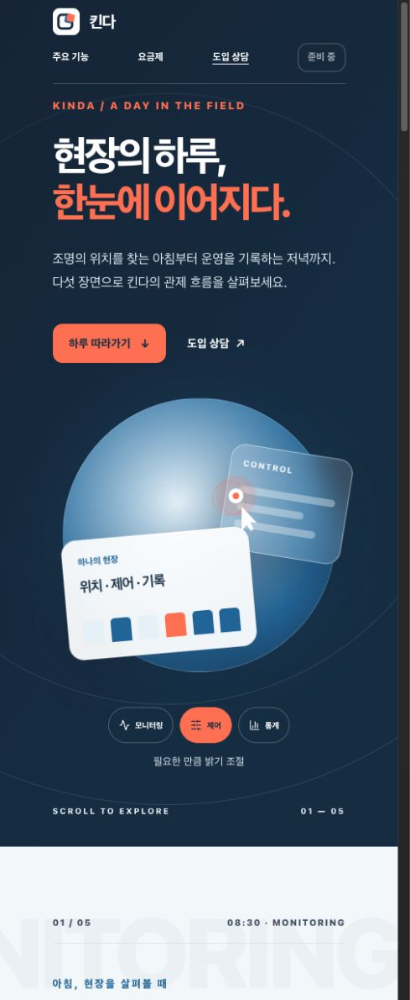
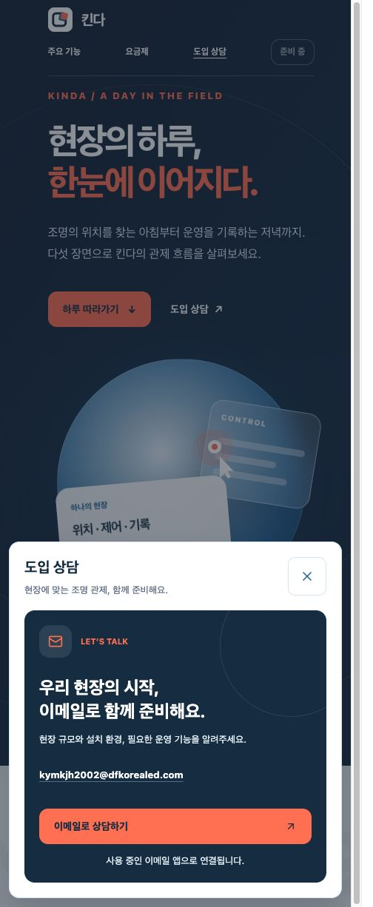

# 공개 사이트 모바일 보완 — 2026-10-13 실제 배포

## 2026-10-16 Plus 준비중 표시 — r7 공개 완료

- 운영 주소 https://kinda.dfkorealed.com/pricing, 공개 source `b536b5ef7f0fe640a1feafcdd8dc0830ac4e1712`, `landing` / `20261016-landing-ui-r7`. [정확 커밋 Public Landing Release 성공](https://github.com/dfkorealed/led-control-service/actions/runs/38837111557), artifact `12019083189`. 공개 unit37/Chromium12·실패/skip/flaky0·scoped blocked0이다. 기존 운영 소스 대비 제품 변경은 Plus 가격을 `준비중`으로 바꾸고 월 단위를 숨기는 범위다.
- CI ZIP SHA `944dc4cf54dfd2ceaf3b73eb41cc69e30eaa7594685147345883ecca0e0c27bf`, source SHA `769f60352d3df0f84e920b602402034419b0fec6558cc2670496884e31b7fe90`, artifact SHA `2ca8a3b74915b6c8172e52b000196244825ec5b902893d1308f09a92023c0261`, proof file SHA `d7e99fde0e6a1e31138460f6a3dc763bd79fff739916bcee1bda8640b98d22e3`. 공식 MCP 인증의 refresh 만료 뒤 기존 프로필 로그인을 갱신하고 동일 회사 계정456721863474를 확인했다. CI proof와 새 local build/source/artifact guard를 통과했다.
- 기존 Sydney/private S3/OAC/CloudFront에 불변10파일 게시, stack UPDATE_COMPLETE·distribution Deployed·invalidation `IBZXEETJW54LB3YQ2F38R10ADS` Completed·소유 lock 삭제·engine exit0. 공식 MCP 추가3read도 실제 api_calls 성공과 같은 상태를 확인했다. 회사/CloudFront 두 HTTPS smoke exit0(공개3경로200·내부/API/unknown/concepts/archive404·보안 헤더/HTTPS 계약).
- 실제 운영 Chromium320/637/1440px에서 Plus `준비중`·월 단위0·이전 가격0, Basic `99,000원 / 월`, 가로 넘침0을 확인했다. Plus 상담의 선택 문맥·이메일 CTA·Escape 닫기를 확인했고 API 요청0이다. 새 JS `/assets/landing/public-eSjXLKbU.js`. [실제 운영637px 화면](pricing-ready-637-r7.jpg)은 자동 Chromium 캡처이며 native 수동 검증·메일 전송/수신·관제/장비/HIL 검증으로 확대하지 않는다.
- 이번 작업은 기존 공개 후보만 사용했다. MAIN/BIO/API/DB/Gateway·DNS/무료 플랜/리전은 변경하지 않았다. 원시 로그와 CI proof·공식 API 응답은 후보의 ignored `.local`에 보존했다.

## 2026-10-13 공개 페이지 간격·상담 카드 정리 — r6 공개 완료

- 실제 공개 소스 `2627a80d7717e51f83ee75f4a75a7aa2969dfc4d`, `landing` / `20261013-landing-ui-r6`. [동일 SHA Public Landing Release 성공](https://github.com/dfkorealed/led-control-service/actions/runs/38388627479), artifact `11806909424`, 공개 unit 37/37·Chromium 12/12·실패/skip/flaky 0·scoped blocked 0. 독립 검토 C/I/M 0, frozen source 25/25를 확인했다.
- CI ZIP SHA `96a1d10c5e5beee15a75afe6c5e9f65ab2b647c66f1d78841dbb47b1925b130f`, source SHA `e95b254f60d0d461c3110582ce0df8dc90099ebd258bd41adb26e9df6a5c490f`, artifact SHA `2e0cc1812c78ca3b63c0a323bf6f77288421a0095b88bc07528ea0bff147cabd`, proof file SHA `01c8c6a72a1c3b15e4c1b56f43bcda2991f675312d71617f471e537c2c7e8eb2`. CI proof와 새 local build/source/artifact guard를 통과한 뒤 공식 AWS MCP로 게시했다.
- 기존 Sydney/private S3/OAC/CloudFront에 불변 10파일 게시, stack UPDATE_COMPLETE·distribution Deployed·invalidation `I90YIJQJLOJ7NB4NPI9K0LMNDL` Completed·소유 lock 삭제·engine exit 0. 회사/CloudFront 두 HTTPS smoke exit 0: 공개 3경로 200, 내부/API/unknown/concepts/archive 404 및 보안 헤더/HTTPS 계약 통과.
- 실제 운영 Chromium 320/390/637/720/1440px에서 주요 기능·요금제 제목 여유 32px 이상과 가로 넘침 0을 확인했다. 보고된 637×1226px에서 두 페이지 여유는 37px다. 320/637/1440px 상담은 외곽 투명·padding/border 0·중복 헤더 0, 남색 내부 카드·Plus 문맥·이메일 CTA·닫기·Tab trap·Escape·초점 복귀를 확인했다. Feature overview 안내 0개·demo disclaimer footer 0개이며 기존 footer 예시 안내와 상세 hash 이동은 유지됐다. 새 JS `/assets/landing/public-Bc8C3zXJ.js`.
- [주요 기능 화면](features-637-r6.jpg), [요금제 화면](pricing-637-r6.jpg), [상담 카드](contact-637-r6.jpg)는 실제 운영 주소의 자동 Chromium 화면이다. In-app 수동 검증 또는 메일 발송/수신·API/관제·장비/HIL 검증으로 확대하지 않는다. 무료 플랜·Sydney·DNS·전체 Software CI 정책과 외부 MAIN 변경은 유지했다.

## 2026-10-13 히어로 정리·추가 간격 — r5 공개 완료

- 실제 공개 소스 `f3f97f3f2f54a1b055364db6948a8e63229b63de`, `landing` / `20261013-landing-ui-r5`. [동일 SHA Public Landing Release 성공](https://github.com/dfkorealed/led-control-service/actions/runs/38370409105), artifact11798773328, unit37/Chromium12·실패/skip/flaky0, scoped blocked0.
- CI ZIP SHA `52884ac37ef61c3ca1df633623f7e6bad200fd6515780ae564549e034a082d26`, source SHA `0c9386bf03e1ac04fde3e60638dc547142f20affdb22718d81c924f67005d42c`, artifact SHA `43b79a00a50adb1553ebc0d6c0f4cceb5c624ae4c4472a9ad90586dfe2d067af`. CI proof와 fresh local build/source/artifact guard 통과 후 기존 공식 MCP transport로 게시했다.
- 기존 Sydney/private S3/OAC/CloudFront에 불변10파일 게시, UPDATE_COMPLETE/Deployed, invalidation `I59BDHZAF9M6IDP3JPKFNMWKEL` Completed, 소유 lock 삭제와 engine exit0. 회사/CloudFront 두 HTTPS smoke exit0(공개3경로200·내부/API/unknown/archive404·보안헤더/HTTPS 계약) 확인.
- 공개627×1226 Chromium 터치 화면에서 정상 motion을8회 관찰: 실제 최소59px 간격, 겹침/가로넘침0. 미리보기 버튼 그룹0·설명문구0, 새 JS `public-CmxkjRIG.js` 확인. In-app CUA는 kernel assets 오류로 실행되지 않아 이번 화면은 자동 Chromium 증거이며 수동 in-app 검증으로 기록하지 않는다.
- [새 공개 모바일 화면](hero-627-r5.jpg). 기존 아래 r4 화면·선택 버튼 설명은 당시 구현 이력이다. 무료 플랜/Sydney/DNS/API/DB/장비 변경 없이 공개 랜딩만 갱신했다.

## r4 공개 결과 (이전 이력)

- 주소: https://kinda.dfkorealed.com/
- 실제 공개 소스: `3222fb34bb196c62142420b3fc02dc13263d1cbc` (이후 문서 커밋과 구분)
- 모드/릴리스: `landing` / `20261013-landing-ui-r4`
- 동일 Sydney 전용 stack `kinda-landing-prod-20261012`, private bucket `kinda-landing-456721863474-web-20261012`, CloudFront `E2XZYU4N91AW5N` 재사용. 무료 플랜·DNS·API·DB·장비 변경 없음.
- 실제 10파일 게시, stack UPDATE_COMPLETE, distribution Deployed, invalidation `I9GDZQWNV5R2KFGX60QHF1VQ9W` Completed, 소유 잠금 삭제와 deployment engine exit0 확인.
- 회사 도메인과 CloudFront 주소 모두 HTTPS smoke exit0: 공개3경로200, 로그인/내부/API/unknown/concepts/archive404, HTTPS/보안 헤더 계약 확인.

## 정확 CI와 산출물

[Public Landing Release SUCCESS](https://github.com/dfkorealed/led-control-service/actions/runs/38326334739), job `115065759758`, artifact `11780438871`.

- 공개 unit37/37, Chromium12/12, 실패/제외/재시도0. 기존 경로6개와 모바일·조작6개를 유지하고 desktop 케이스 안에 세 선택 버튼의 hover 배경/4.5:1 이상 대비 검증을 추가했다.
- ZIP SHA `c7fdfb13df6cbd3fdeda123bfabec3c94cab34c22445143844b54ab122c061dc`
- source SHA `09fd8671bb63cb72ade5367631ce36df4fb72916f8200f1f08377e66ab022bbc`
- artifact manifest SHA `2744a84d79de94b5ead6070f906de4924c527337ac4ed8e0690799c96493d310`
- proof SHA `7cab310b8193e7a0cb94a28070b55f97d5b05f77688870df8a5ba7dbdabffaf8`
- CI proof 다운로드 SHA/경로 검증 후 새 local build와 실제 release guard를 통과했다. 정확 코드의 랜딩 전용 관문이며 전체 Software CI/API·모바일 앱·장비/HIL 성공으로 확대하지 않는다.

## 실제 브라우저 확인

In-app browser 실제 viewport는 504×1226이었다. 390×844 override를 요청했지만 실제 DOM은504×1226을 유지해 수동390 검증으로 기록하지 않는다. 자동 Chromium320/390/504 검증과 구분한다.

- 새 JS `assets/landing/public-CQyZYFoM.js`, CSS `assets/landing/public-CHwbFb6b.css` 확인.
- 504px 실제 hero 시각 간격43px, 가로 넘침 없음. CONTROL/STATISTICS 선택에 패널·포인터·그래프·설명 반응 확인.
- 실제 hover=true/pressed=true 선택 버튼 배경 `rgb(255,122,92)`, 글자 `rgb(21,50,74)` 확인. r3에서 발견한 hover 선택 배경 경쟁은 실제 RED→한 줄 보완→GREEN→정확 CI→r4 공개로 해결했다.
- 이메일 상담 카드, 전화 링크0, 열기/닫기 확인. 이메일 앱 CTA 확인만 수행했으며 메일 발송이나 수신은 검증하지 않았다.
- 신규 요금제 문장, 회사 페이지 nav0, 주요 기능/요금제/홈 이동 확인. 임시 viewport 설정 해제 뒤 홈으로 복귀했다.

## 실패 이력과 도구 제한

r2는 MCP binary body 직렬화 BadDigest로 activation 전에 중단하고 소유 잠금을 삭제했다. 비공개 부분 archive는 보존한다. 로그인 갱신 후, 변경 없는 PNG는 r1 원본 VersionId/ETag를 고정한 실제 다운로드와 local bytes/SHA/크기 대조 뒤 destination IfNoneMatch='*', 양 owner, 원 metadata/type/cache를 유지하는 CopyObject로 게시했다. 복사 결과 source version·destination version/ETag와 version-pinned HeadObject의 SHA/길이/type/cache를 검증한 뒤에만 기존 engine 성공을 반환했다. CLI 리소스 명령이나 무결성 검사 제거·권한 확장 없이 공식 AWS MCP를 사용했다.

r3의 다섯 주석 보완 공개 뒤 hover 문제를 추가 발견했고 r4로 수리했다. 이전 release archive와 rollback 자산은 유지한다. 원시 로그·MCP 응답·proof는 candidate worktree의 ignored `.local`에 보존하고 인증 정보/서명 URL은 이 문서나 공개 자산에 포함하지 않는다.
